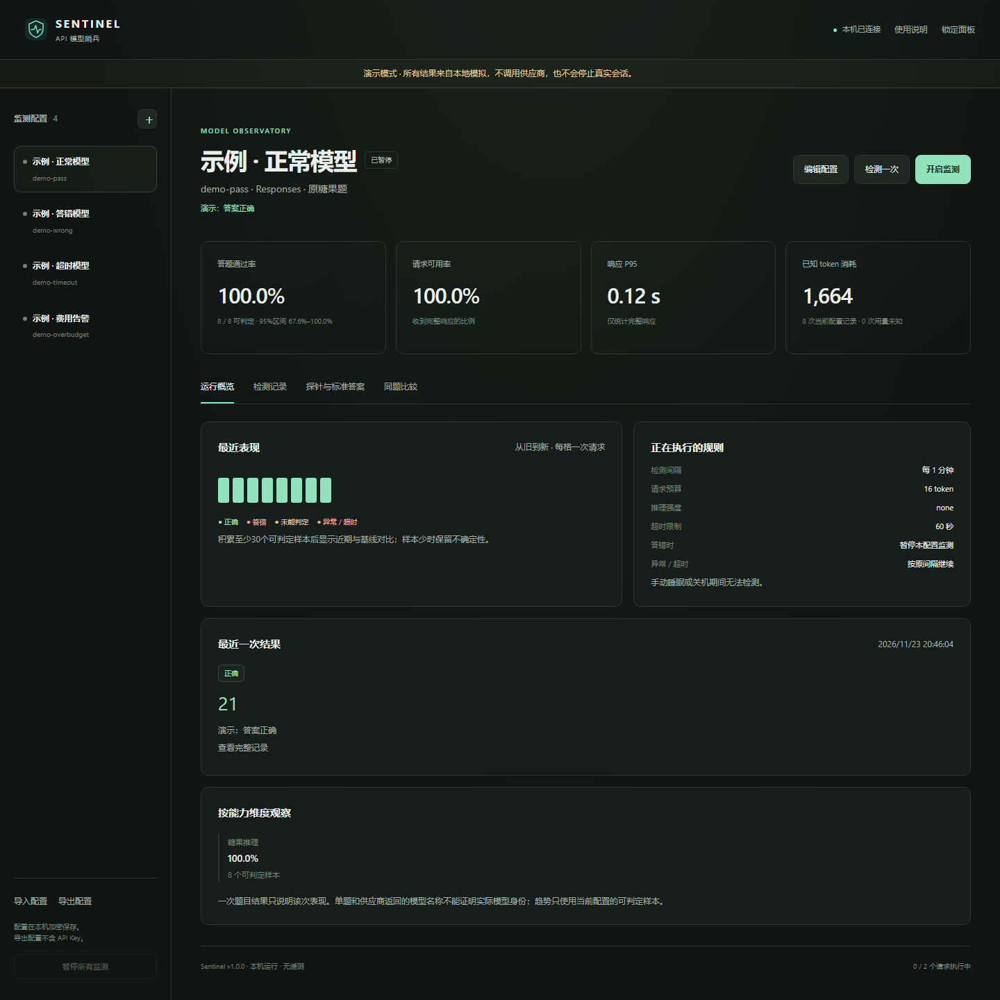

# Sentinel · API Model Quality Monitor

[](https://github.com/indulgeuuu-del/api-model-sentinel/actions/workflows/ci.yml)

**A local observatory for answer correctness, availability and reported token usage across OpenAI-compatible providers.** [简体中文](README.md)

The browser is a dashboard. A standalone Node.js process runs the schedules even when the browser is minimized or closed. No runtime packages, cloud account, telemetry or remote frontend assets are required.



## Start

Install [Node.js 22.14+](https://nodejs.org/), download and extract the [latest release](https://github.com/indulgeuuu-del/api-model-sentinel/releases/latest), then double-click `Start.cmd` on Windows. `Demo.cmd` uses simulated providers and cannot interrupt real Codex work. `Stop.cmd` stops the production service and pauses all monitors.

On other platforms, or for foreground operation:

```sh
node bin/sentinel.cjs serve --open
# Or: supervise --open (bounded crash restarts)
node bin/sentinel.cjs status
node bin/sentinel.cjs open
node bin/sentinel.cjs stop
```

Keep the terminal open for foreground operation. Demo commands require `--demo`. Use the same `--data-dir PATH` on every command when choosing a custom directory. Windows launchers run the supervisor in the background; they do not register a startup task.

## Features

- Responses and Chat Completions, explicit endpoint paths and configurable reasoning/token parameters.
- Up to20 profiles with a global two-request concurrency limit and one in-flight request per profile.
- Original candy reasoning question, or seeded rotating candy, arithmetic, shortest-path, table and JSON tasks. Locally computed reference answers; reproducible versions and seeds.
- Defaults:16 output tokens, reasoning `none`, one request per cycle. No automatic retries, hidden protocol fallbacks or budget increases.
- Correct answers pass, completed wrong answers fail. Budget violations produce warnings without vetoing a correct answer. Timeouts, incomplete output and provider errors continue the next scheduled cycle.
- A completed wrong answer pauses the affected monitor. Optional experimental Windows Codex Desktop interruption uses a snapshot of local active chats.
- Separate correctness/availability metrics, Wilson confidence intervals, latency percentiles and known token totals. Settings, credentials and explicit provider-group tags partition statistics.
- Same-question comparison, secret-free config export, sanitized JSON/CSV history, AES-256-GCM persistence and atomic previous-state backups.
- Windows DPAPI protection of the encryption key; Unix key file mode600. Loopback-only HTTP with connection-code authentication, Host/Origin checks and CSP.

**Codex interruption is experimental.** It depends on private desktop IPC. The inspected Windows Desktop build `26.1117.4957` does not expose the required control pipe, so readiness checks reject enabling the feature. Core monitoring remains available. Stop orchestration is tested with simulated adapters; no live user work was interrupted during validation.

## Interpretation

The original Chinese candy probe keeps the user-selected prompt and answer21 under a shape-aware drawing strategy. Generated variants explicitly state the drawing rules. A single probe does not establish model identity or overall capability. Reported token usage and requested reasoning limits depend on provider compliance; unknown usage is never presented as zero.

The main interface and detailed documentation are Chinese. English UI translation is on the [roadmap](docs/roadmap.md).

## Development

```sh
npm ci
npx playwright install chromium
npm run verify
npm run package
```

CI tests Node22/24 on Windows, Ubuntu and macOS, plus Chromium desktop/mobile browser flows on Ubuntu. Tests use loopback mock providers without live credentials. See [validation scope](docs/validation.md), [security policy](SECURITY.md), [contribution guide](CONTRIBUTING.md) and [MIT license](LICENSE).

An [opt-in live acceptance tool](docs/live-testing.md) saves each sanitized response before sending another request and stops a batch on reported token limits, rejected credentials or unknown usage. Ten authorized `gpt-6-sol` requests against one gateway passed on 2026-11-23; that gateway exceeded requested output/reasoning limits. See the [measured scope and usage](docs/validation.md).
