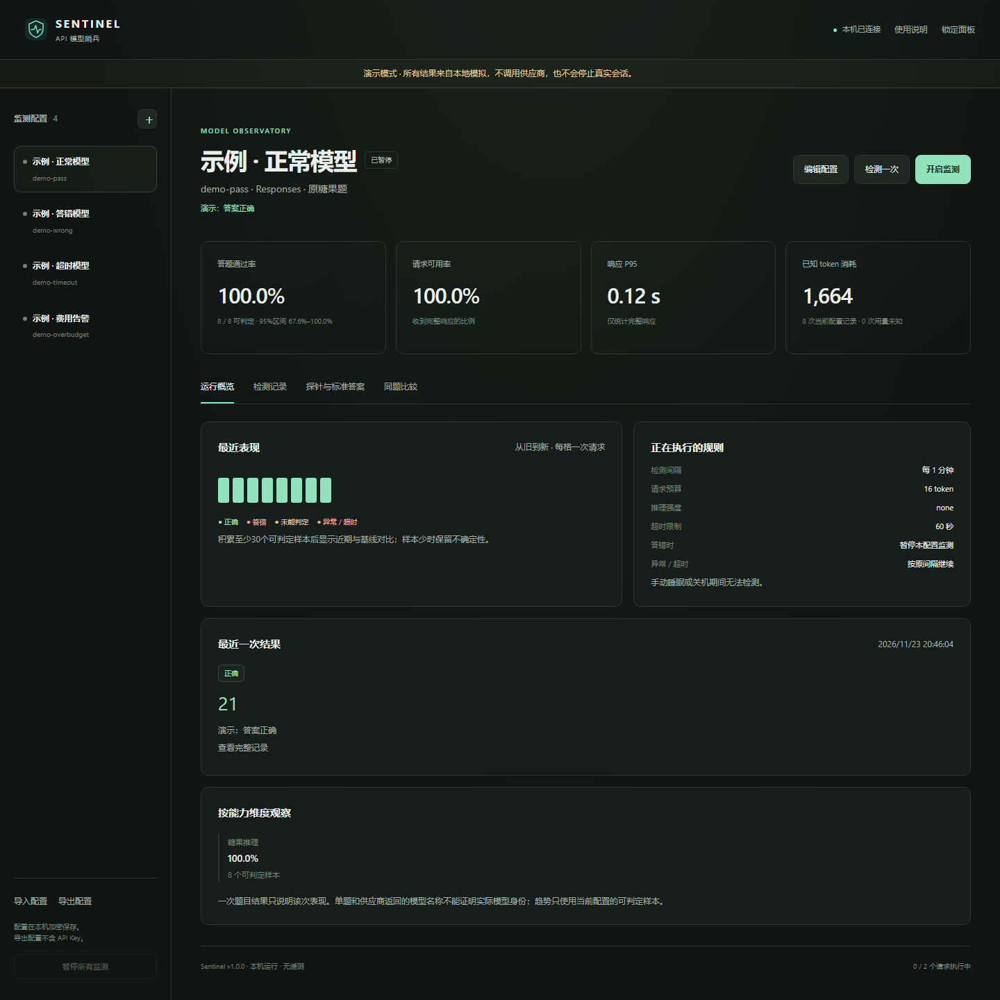

# Sentinel · API 模型哨兵

[](https://github.com/indulgeuuu-del/api-model-sentinel/actions/workflows/ci.yml)
[](LICENSE)

**在自己的电脑上，持续记录第三方 API 的答题质量、可用性和 token 消耗。**

浏览器只负责展示。检测由独立 Node.js 后台执行，最小化或关闭网页后仍可运行。支持 Responses 和 Chat Completions，默认保留原糖果题、16 token 输出预算和 `reasoning.effort=none`，每个周期只发送一次请求。

[English](README.en.md) · [下载发行版](https://github.com/indulgeuuu-del/api-model-sentinel/releases/latest) · [使用手册](docs/usage.md) · [探针与判定](docs/probes.md) · [架构](docs/architecture.md)



## 能做什么

| 功能           | 行为                                                                         |
| -------------- | ---------------------------------------------------------------------------- |
| 多配置后台监测 | 最多20个配置、全局最多2个并发请求；单配置不重叠                              |
| 可复算探针     | 原糖果题，或糖果变体、运算、图路径、表格筛选、JSON指令五维轮换               |
| 清晰判定       | 答对通过、完整答错失败；超时、接口异常、拒答和未完成单独记录                 |
| 费用控制       | 默认16输出token、关闭推理；无自动重试、无静默参数回退、无自动扩预算          |
| 后台恢复       | 以主机时钟调度；异常退出可由监督进程重启，中断请求不自动重发                 |
| 数据观察       | 分维度通过率、Wilson 95%区间、近期与基线比较、P50/P95、已知token统计         |
| 同题比较       | 两个配置使用同一个随机种子和题目，各发一次请求                               |
| 本机保存       | AES-256-GCM加密，Windows主密钥由DPAPI保护；无遥测、无CDN资源                 |
| 迁移与导出     | 无Key配置JSON、脱敏JSON历史、Excel公式防护CSV、旧版后台配置导入              |
| Codex停止保护  | **实验性可选适配器**；自动完整答错时暂停监测，并尝试停止快照中的本机活动会话 |

超预算或供应商仍产生推理token时，只增加费用提示，**不改变正确答案的通过结果**。自动监测遇到完整错误答案时暂停该配置，其余异常按原间隔继续。

> **Codex兼容性：** 停止保护依赖非公开桌面IPC，不能保证适配每个版本。当前检查过的 Windows Desktop `26.1117.4957` 未暴露旧控制管道，保护能力检查会明确拒绝开启；API监测照常可用。停止控制逻辑经过模拟验收，未拿用户真实工作会话作停止试验。详见[兼容性与验证范围](docs/validation.md)。

## 三步开始

1. 安装 [Node.js LTS](https://nodejs.org/)（22.14及以上）。
2. 下载发行版ZIP，解压到普通文件夹。Windows双击 **`Start.cmd`**；先体验则双击 **`Demo.cmd`**。
3. 在面板添加配置，先“检测一次”，再“开启监测”。

Windows的 `Start.cmd` 会启动隐藏的监督进程并打开面板。以后再次双击会打开原服务。关闭网页不影响后台；要彻底停止，请双击 `Stop.cmd`。默认不注册开机启动。

macOS / Linux，或希望看终端输出时：

```sh
git clone https://github.com/indulgeuuu-del/api-model-sentinel.git
cd api-model-sentinel
node bin/sentinel.cjs serve --open
```

运行不需要 `npm install`。在这种前台启动方式下，终端需要保持打开。需要异常退出后重启时，可改用 `node bin/sentinel.cjs supervise --open`。

```sh
# 演示：不调用供应商，不操作真实Codex会话
node bin/sentinel.cjs serve --demo --open

# 重新打开、查看状态、停止
node bin/sentinel.cjs open
node bin/sentinel.cjs status
node bin/sentinel.cjs stop
```

演示使用独立数据目录和17656端口；普通服务默认17655。演示的 `open/status/stop` 命令也要加 `--demo`。如果自定义过数据目录，每次命令应带同一个 `--data-dir`。

## 检测结果怎么理解

原糖果题的标准答案为 **21**，沿用“可以根据手感预先决定两种形状各取多少”的题意。新增变体明确写出抽取规则，并由本机算法生成标准答案。固定题适合连续观察，变体用于减少单题记忆的影响。

通过率只统计可判定的对错结果；接口可用率、延迟、费用分别呈现。修改模型、协议、预算、推理参数、超时、Key或分组标签后开始独立统计。供应商后台使用同一个Key切换分组时，请手动更新分组标签。

一次答错说明这次题目没有通过。模型身份、供应商路由和整体能力需要更多独立证据。软件提供观察记录和保护动作，不把单题结果包装成模型鉴定结论。

## 数据放在哪里

| 系统          | 默认目录                          |
| ------------- | --------------------------------- |
| Windows       | `%LOCALAPPDATA%\ApiModelSentinel` |
| macOS / Linux | `~/.local/share/ApiModelSentinel` |
| 演示          | 上述目录名称加 `-demo`            |

目录包含加密配置、最近1000条历史、前一版本备份和本机连接信息。Windows密钥绑定当前系统用户；macOS/Linux密钥文件权限为600。备份时应保留整个目录；不要公开上传它。页面使用本机连接码认证，API Key不会回传给浏览器或写入配置导出。详见 [SECURITY.md](SECURITY.md)。

## 开发与验证

```sh
npm ci
npx playwright install chromium
npm run verify
npm run package
```

测试使用本机模拟供应商，覆盖协议、SSE、取消/超时、重启恢复、存储故障、认证/跨站防护、桌面适配器以及桌面和移动布局的浏览器交互，不消耗真实API额度。CI在Windows、Ubuntu、macOS和Node22/24上运行核心测试，并在Ubuntu运行浏览器验收。发行包附SHA-256校验文件。

查看 [CONTRIBUTING.md](CONTRIBUTING.md)、[测试范围](docs/validation.md)、[路线图](docs/roadmap.md) 与 [CHANGELOG.md](CHANGELOG.md)。欢迎用脱敏复现改进供应商兼容性。

## 许可证

[MIT](LICENSE)。
