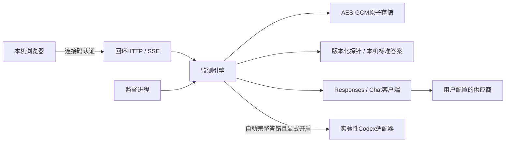

# 架构与维护边界

## 模块

| 位置                                | 责任                                       |
| ----------------------------------- | ------------------------------------------ |
| `src/probes.cjs`                    | 原题、可复算生成器和判定器                 |
| `src/profile.cjs`                   | 输入约束、端点拼接、请求参数和配置指纹     |
| `src/protocol.cjs`                  | 有界HTTP、JSON/SSE解析、用量提取和结果分类 |
| `src/engine.cjs`                    | 多配置调度、并发限制、取消、事件与恢复     |
| `src/storage.cjs`                   | AES-GCM、DPAPI、原子替换、前版备份和进程锁 |
| `src/stats.cjs`                     | 质量/可用率/延迟/用量的分开统计            |
| `src/server.cjs`                    | 回环HTTP API、认证、跨站防护和SSE          |
| `src/guard.cjs` / `desktop-ipc.cjs` | 实验适配层，能力检查、单次停止快照和确认   |
| `src/power.cjs`                     | 监测期间Windows空闲睡眠保持                |
| `public/`                           | 无构建依赖的中文面板，文本按数据渲染       |
| `bin/` / `scripts/`                 | CLI、监督、Windows启动和可复现打包         |

运行时只使用Node内置模块。开发依赖固定为Playwright与Prettier，锁文件提交到仓库。接口认证与供应商Key分离，浏览器仅持有本机连接码。

## 引擎不变量

1. 单配置最多一个请求，全局默认最多两个。准备开启保护时也锁定配置，阻止编辑和比较竞争。
2. 请求开始前先持久化正在执行状态；本地保存失败不发请求。已发请求的取消只能取消本地等待，不能承诺撤销远端计费。
3. 下次执行时间在本次完成后安排，无积压补发。监测不依赖页面定时器；浏览器轮询/SSE只更新视图。
4. 只在自动来源、当前仍启用、确定错误终答时触发保护。暂停/关闭期间的迟到返回被改为取消。
5. 告警先持久化再执行已授权保护。崩溃后执行中告警标为未知，不重试可能已经发生的停止动作。
6. 状态写入失败禁用全部计划并显示fatal。恢复需要检查磁盘、保留数据并重启，不自动清空损坏文件。
7. 修改参数生成新的配置指纹；Key变化使用随机凭据版本标识分隔统计，不暴露Key的散列。后台改变同Key的分组不可自动得知，使用contextTag显式区分。

## 本机HTTP接口

监听地址固定 `127.0.0.1`，不支持配置成公网地址。默认端口17655，演示17656。静态资源与 `/health` 无需认证；其他接口要求 `Authorization: Bearer <本机连接码>`。限制Host、Origin与跨站请求；不提供CORS授权。

| 方法 / 路径                                                | 行为                                          |
| ---------------------------------------------------------- | --------------------------------------------- |
| `GET /health`                                              | 不含配置的服务标识、版本和演示标记            |
| `GET /api/status`                                          | 脱敏配置、调度、统计、告警和电源保持状态      |
| `GET /api/events`                                          | SSE变化提示，不传递敏感状态，客户端再获取快照 |
| `GET /api/history?profileId=...`                           | 全局或指定配置的脱敏历史                      |
| `POST /api/profiles`                                       | 新建配置                                      |
| `PUT /api/profiles/:id`                                    | 修改暂停且空闲的配置                          |
| `DELETE /api/profiles/:id`                                 | 删除暂停配置及对应历史                        |
| `POST /api/profiles/:id/start`                             | 开启该配置计划，启用保护时先做能力检查        |
| `POST /api/profiles/:id/stop`                              | 暂停并取消本地等待                            |
| `POST /api/profiles/:id/run`                               | 单次手动检测，202后从状态/历史获取结果        |
| `POST /api/stop-all`                                       | 暂停全部监测                                  |
| `POST /api/compare`                                        | 用profileIds数组比较两个暂停配置，各请求一次  |
| `POST /api/import`                                         | 校验全部配置后导入，默认暂停并禁用保护        |
| `GET /api/export/config`                                   | 无Key配置                                     |
| `GET /api/export/history?format=csv`                       | JSON或公式防护CSV                             |
| `GET /api/probes/preview?pack=rotating&sequence=0&seed=42` | 生成本地可复算预览，不调用供应商              |
| `POST /api/guard/check`                                    | 只读检查Codex连接能力                         |
| `POST /api/system/shutdown`                                | 暂停监测、响应后关闭服务                      |

写接口要求JSON对象（包括空对象），上限512KiB。供应商响应体上限2MiB、单次等待最多300秒。SSE客户端最多20个，并清理积压连接。面板连接码不是公开多用户认证方案；不要通过反向代理暴露服务。

## 新增能力的路径

新增题目：先定义稳定版本、确定求解器及独立oracle，再加入轮换和维度标签。新增协议：单独实现请求与响应适配，不能静默重试不同协议。新增桌面版本：在guard适配层增加能力探测和模拟夹具，保留未知状态，不因一次请求被接受就宣称会话已停止。
